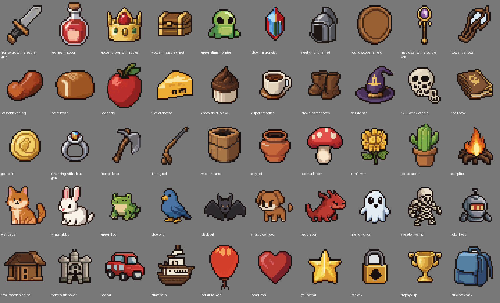
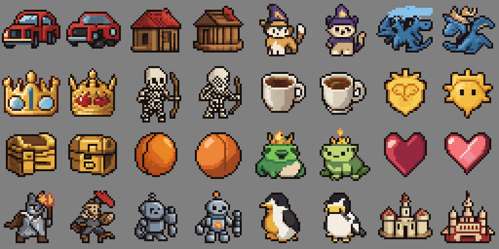

# UbaNova-32

**Text to 32×32 pixel-art game sprites.** UbaNova-32 is a small (42.8M-parameter) autoregressive transformer that draws a sprite one pixel at a time from an English prompt. Every pixel is an exact palette color and the background is truly transparent, so the output is clean pixel art with no blur and no post-processing. It is the 32×32 successor of [UbaNova-16](https://github.com/irhamuba/ubanova-16).

Created by **Muhammad Fahril Irkham** ([@UbaNova](https://x.com/UbaNova)) · [GitHub](https://github.com/irhamuba) · [Hugging Face](https://huggingface.co/ubanova)



*One sample per prompt with the default settings, prompts under each sprite.*

## Quick start

```bash
git clone https://github.com/irhamuba/ubanova-32.git
cd ubanova-32
pip install -r requirements.txt     # Python 3.9+; CPU-only torch: pip install torch --index-url https://download.pytorch.org/whl/cpu

python generate.py "red potion" "iron sword" --n 4 --out sprites.png
```

The weights (`model32_v11.pt`, 86 MB, and `palette.npy`) are downloaded from [Hugging Face](https://huggingface.co/ubanova/UbaNova-32) on first use. To use local files, put them in `weights/` or pass `--model` and `--palette`.

**CPU and GPU.** The device is chosen automatically: an NVIDIA GPU (CUDA) if one is available, otherwise the CPU. Force one with `--device cpu` or `--device cuda`. On GPU the model runs in FP16 autocast; on CPU in FP32.

Useful options:

| Option | Default | Meaning |
|---|---|---|
| `--n` | 4 | sprites per prompt |
| `--cfg` | 2.0 | classifier-free guidance; how closely to follow the prompt |
| `--temperature` | 1.0 | sampling temperature |
| `--top-p` | 0.9 | nucleus sampling; removes stray off-palette specks (1.0 disables it) |
| `--bg` | off | fill the background; name a color in the prompt ("..., on a blue background") |
| `--size` | 32 | `32` = native 32×32; `16` = chunky 16×16 look (saved as 16×16) |
| `--fill` | auto | object size on the canvas: `auto`, `any`, `low`, `mid`, `high` |
| `--detail` | auto | color count / shading: `auto`, `any`, `low`, `mid`, `high` |
| `--seed` | none | fixed seed for reproducible output |
| `--scale` | 8 | nearest-neighbor upscale of the saved PNG |
| `--device` | auto | `cuda` or `cpu` |

The defaults are the best setting from our evaluation: guidance 2.0 keeps objects inside the canvas and their sizes closest to real sprites.

```bash
python generate.py "green slime, on a light blue background" --bg
python generate.py "wooden chest" --size 16
python generate.py "golden crown" --detail high --fill mid
```

### Python

```python
from infer32 import SpriteGenerator32

gen = SpriteGenerator32()                 # cuda if available, else cpu
images = gen.generate("golden crown with rubies", n=4, seed=42)   # list of 32x32 RGBA PIL images
images[0].resize((256, 256), 0).save("crown.png")
```

Speed: about 0.8 s per sprite on an NVIDIA T4 (key-value caching, guidance on).

## How it works

- A caption is encoded by the frozen text encoder of `openai/clip-vit-base-patch32` (32 token states).
- Two condition tokens follow the text: **size** (native 32×32 or 16×16 look) and **background** (transparent or filled). Version 1.1 adds **fill** (object size) and **detail** (color count) to these tokens; each can be left at "any".
- The model predicts each of the 1,024 pixels from the ones before it, in raster order. Each pixel is one of 4,097 classes: 4,096 palette colors plus transparent.
- Classifier-free guidance (10% caption dropout during training) and nucleus sampling are used at inference.

| | |
|---|---|
| Architecture | decoder-only transformer, pre-LayerNorm |
| Width / layers / heads | 512 / 12 / 8 |
| Trainable parameters | 42.84M (CLIP text encoder frozen, not counted) |
| Sequence | 32 text + 2 condition + BOS + 1,024 pixels |
| Initialization | UbaNova-16 weights |
| Training data | 155k 32×32 sprites from [azyg0s/pixelart-172k](https://huggingface.co/datasets/azyg0s/pixelart-172k) and 500 from [moss-pixelart-64](https://huggingface.co/datasets/ProbablyHumanAB/moss-pixelart-64), mixed with 16×16 sprites from [Pixel Art Atlas](https://huggingface.co/datasets/Angais/pixel-art-atlas-1.4m) and [Krea-2 synthetic](https://huggingface.co/datasets/Angais/krea-2-pixelart-16x16-synthetic) upscaled 2× for the 16×16 look |
| Training | v1: 3 epochs, 20,973 steps, batch 32, AdamW, lr 2e-4 cosine, FP16, one NVIDIA T4; v1.1: +1 epoch (6,991 steps, lr 5e-5) with fill/detail controls |
| Weights | FP16, 86 MB |

## Evaluation

On 256 held-out captions, scored with CLIP ViT-B/32 (sprites rendered on gray, upscaled to 224 px):

| | CLIP score | Caption retrieval R@1 | R@5 | Colors / sprite | Stray pixels / 1000 | Touches border |
|---|---|---|---|---|---|---|
| Real sprites (reference) | 29.07 | 57.4% | 79.7% | 22.1 | 0.04 | 0.04% |
| UbaNova-16 (upscaled) | 26.75 | 29.3% | 54.3% | 15.9 | 0.35 | 24.6% |
| **UbaNova-32 v1.1 (default)** | **28.87** | **50.0%** | **77.0%** | **14.9** | **0.06** | **0.9%** |

- Held-out loss 0.446 nats/pixel (0.64 bits/pixel), 89% next-pixel accuracy.
- None of 256 generated sprites copies a training sprite; generated sprites are farther from the training set than real held-out sprites.
- Background control: with `--bg` and a named color, 100% of sprites get a uniform background in that color; without `--bg` the border is always transparent.
- 16×16 mode: 99.7% of 2×2 blocks are one color, so it reads as true 16×16 pixel art.
- Free-form prompts (below): CLIP score 30.2, R@1 87.5%.



*Free-form prompts, two samples each: a red car; a wooden house with a red roof; a cat wearing a wizard hat; a blue dragon breathing fire; a golden crown with three rubies; a skeleton holding a sword; a cup of coffee; a smiling sun; a treasure chest full of gold coins; an orange basketball; a green frog with a crown; a pixel heart; a knight riding a horse; a robot holding a flower; a penguin wearing a scarf; a castle on a hill.*

Known limitations:
- Color words are followed for red, orange, cyan and green (75–100%) but poorly for yellow (31%) and pink (0%); see `assets/colors.png`.
- Fewer colors per sprite than real sprites (15 vs 22): shading is simpler.
- Relations between objects are sometimes ignored.
- Output is 32×32 (or the 16×16 look) only.

## Repository layout

| Path | What |
|---|---|
| `ubanova32.py` | model definition, condition tokens, KV-cached sampler |
| `infer32.py` | `SpriteGenerator32` (weights from `weights/` or Hugging Face) |
| `generate.py` | command-line generator |
| `training/` | Kaggle GPU scripts used for the release: `prep32.py` (data), `train32.py` (v1), `train32b.py` (v1.1). They expect UbaNova-16's `train.py` and the data as Kaggle inputs. |

## Data and license notes

- **Code and weights:** Apache License 2.0 (see `LICENSE` and `NOTICE`).
- **Training data:** azyg0s/pixelart-172k (MIT), moss-pixelart-64 (Apache-2.0), Pixel Art Atlas and Krea-2 synthetic (CC0-1.0). The Atlas and Krea-2 images were generated with Krea 2; check the [Krea 2 license](https://www.krea.ai/krea-2-licensing) yourself before selling generated sprites.
- Some platforms require you to disclose that images are AI-generated.
- Do not use the model to imitate characters or brands you do not own.

## Attribution

If you use UbaNova-32 or build on it, please credit:

> **UbaNova-32 by Muhammad Fahril Irkham (@UbaNova)** — https://github.com/irhamuba · https://huggingface.co/ubanova

and keep the `NOTICE` file when redistributing. The UbaNova-16 report: [doi:10.5281/zenodo.24214385](https://doi.org/10.5281/zenodo.24214385).

## Support the project

If UbaNova is useful to you, donations help pay for GPU time for the next models (64×64 and 128×128).

| Network | Address |
|---|---|
| EVM (Ethereum, BNB Chain, Polygon, Base, Arbitrum, …) | `0x3e888de8c66d2efc9456d730c566563e04ed63e0` |
| Solana | `9kSnpiHjrrFMrg8PQXAytDYwtjDcDNzc1xDnDq3AxkWY` |
| Tron (TRX / TRC-20) | `TLvdtLrzknmP4Xjkc59w8UwzGERBDS5ByW` |
| Bitcoin (Taproot) | `bc1p7hhnfzamcp58n093jfd5ncxz55mejruscwjsclqe5esd86ptxx9q35mqdm` |
| Sui | `0xa5c680ee5ef209134979eeac30cc192fb5e3cf40cb40483fbca50c229b07d085` |

Please double-check the network before sending; funds sent on the wrong network cannot be recovered.

## Links

- X: [@UbaNova](https://x.com/UbaNova)
- GitHub: [irhamuba](https://github.com/irhamuba)
- Hugging Face: [ubanova](https://huggingface.co/ubanova)
- UbaNova-16: [GitHub](https://github.com/irhamuba/ubanova-16) · [Hugging Face](https://huggingface.co/ubanova/UbaNova-16)
